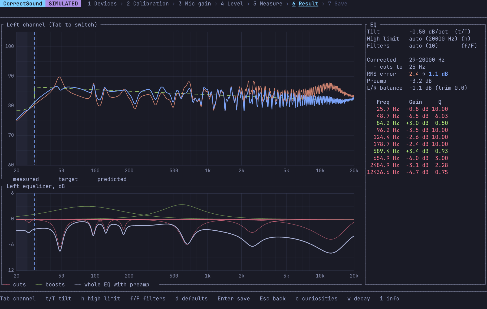

# CorrectSound

**Room correction for Linux, in a terminal.** Plug in a miniDSP UMIK-1, answer a few prompts,
and a measured, verified equalizer for your speakers and room is loaded into EasyEffects. Carry
a bass trap around the room and watch the bass change as you walk.

**Everything else is on the website: how it works, a tour of every screen, the science, and
what's new. <https://arturzielazny.github.io/correctsound/>** Or try the whole wizard in your
browser first, against a simulated room: <https://arturzielazny.github.io/correctsound/try/>



> Made to be taken apart: give it to your own AI coding agent and make it fit your setup
> (see [Make it yours](#make-it-yours)).

## Install and run

```sh
curl -fsSL https://arturzielazny.github.io/correctsound/install.sh | sh
correctsound --simulate    # the whole app against a simulated room, no hardware, any OS
correctsound               # measure your speakers
correctsound --tty         # in this terminal instead of a window of its own
```

It opens in a window of its own, drawn on the GPU. Where no window can be opened (no display
or GPU, or a login over SSH), it shows the same screens and keys in the terminal by itself.

The script installs the ready-made program for Linux or macOS from the
[latest release](https://github.com/arturzielazny/correctsound/releases/latest) into
`~/.local/bin`; Windows has a zip there. From source, with Rust:
`cargo install --locked --git https://github.com/arturzielazny/correctsound`
(`--no-default-features` builds it without the window, for the terminal only).

On Linux it needs PipeWire (`pw-cat`, `pw-dump`), WirePlumber (`wpctl`) and `alsa-utils`
(`amixer`). EasyEffects is optional: without it you still get the EQ files. On macOS and Windows
only the simulator and saved sessions work so far.

Five steps, one key each: setup, level, measure, result, save. Setup is one screen for the mic,
its calibration file (type the serial number once; the file is downloaded and saved), its gain
and the output, and on later runs it is one Enter. On the
way, `p` opens live placement for room treatment, `r` your room seen from above, `w` the bass
decay, `c` curiosities about your room, `i` how it works. `Esc` goes back, `q` quits, and
everything the app changes is put back when it exits. On the save step you install the EQ
(`a`), verify it with the sweeps played through EasyEffects (`v`), then keep it or roll
EasyEffects back to how it was (`u`).

Other commands: `correctsound sessions` lists saved measurements, `correctsound review [N]`
opens one again, `correctsound fit SESSION_DIR` redoes its EQ, `correctsound devices` shows what
setup sees. `correctsound --help` has the rest.

## Questions and feedback

Ask, share your results or suggest ideas in
[Discussions](https://github.com/arturzielazny/correctsound/discussions); report bugs in
[Issues](https://github.com/arturzielazny/correctsound/issues).

## Make it yours

CorrectSound does one setup well: Linux, PipeWire, EasyEffects, a UMIK-1, two speakers. Yours
may differ: macOS, Windows, another mic, a subwoofer, CamillaDSP. **Clone the repository and give
it to your AI coding agent.** [CONTRIBUTING.md](CONTRIBUTING.md) has prompts to start from,
[AGENTS.md](AGENTS.md) the rules and the code's layout, [IDEAS.md](IDEAS.md) what is planned.
When it works for you, open a pull request.

```sh
cargo test                  # DSP, fitting, parsers, and the whole wizard on the simulator
cargo run -- --simulate     # the app, no hardware
./web/build.sh              # the web page's version (docs/try/; see web/README.md)
```

## License

[MIT](LICENSE). Take it, change it, ship it.
